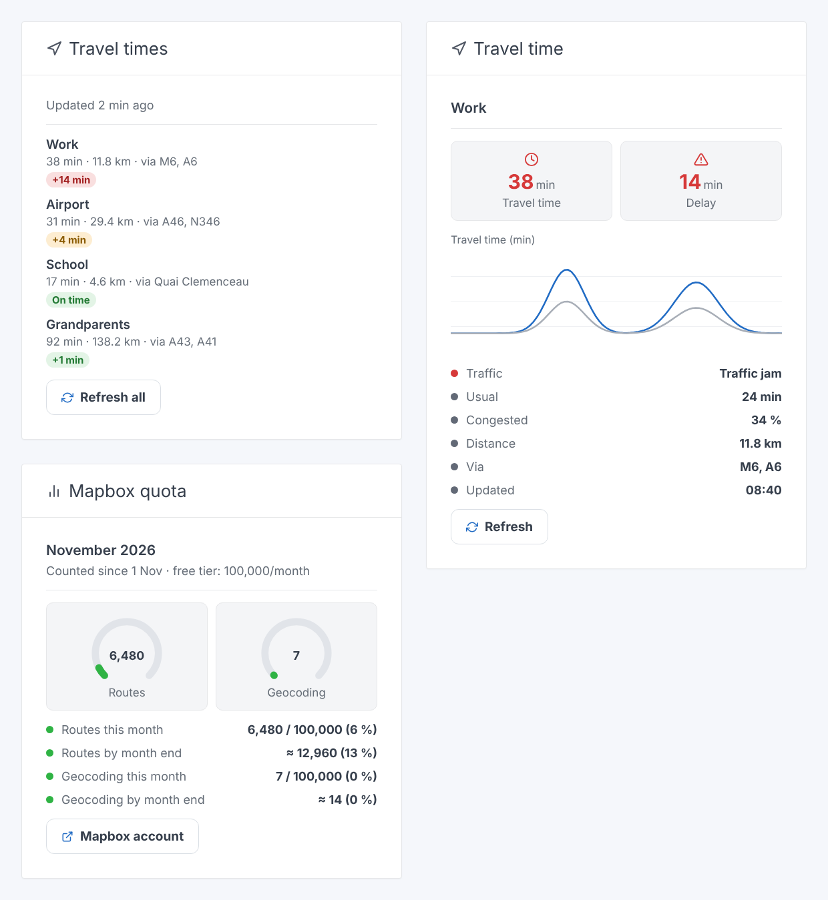

# Gladys Mapbox Traffic

External integration for [Gladys Assistant](https://gladysassistant.com) that
tracks the **travel time of your routes** (home → work…) with live traffic,
through the [Mapbox Directions API](https://docs.mapbox.com/api/navigation/directions/).

- 📈 **Chart** of the travel time, compared with the usual one (historized
  features + dashboard widget);
- 🧭 **"Travel times" widget**: every route at a glance, with a delay badge and
  a "Refresh all" button;
- 📊 **"Mapbox quota" widget**: the requests of the month against the 100,000
  free ones, and the estimate for the end of the month (local counter kept in
  `/data`);
- 🛣️ **Waypoints**: force a route through the places you choose instead of the
  fastest way;
- 🚗 **Traffic jams** detected from the Mapbox congestion annotations (share of
  the route in heavy traffic);
- ⏱️ **Abnormally long travel time** compared with the typical one;
- 🎬 **Scenes**: 4 triggers (traffic jam / cleared, abnormal travel time / back
  to normal) and 1 action ("Get the travel time of a route").

Built from the official
[integration-template-js](https://github.com/GladysAssistant/integration-template-js)
template and the [`@gladysassistant/integration-sdk`](https://github.com/GladysAssistant/integration-sdk-js)
SDK.

User documentation: [docs/en.md](./docs/en.md) · [docs/fr.md](./docs/fr.md) ·
[docs/de.md](./docs/de.md) · [docs/es.md](./docs/es.md).

## Widgets



| Widget           | Shows                                                                                                                                                                                                                                |
| ---------------- | ------------------------------------------------------------------------------------------------------------------------------------------------------------------------------------------------------------------------------------ |
| **Travel times** | Every route (or the ones picked in its settings): travel time, distance, main roads and a delay badge colored by the traffic. Tapping a route shows its details and a Google Maps link; **Refresh all** refreshes every route shown. |
| **Travel time**  | One route: travel time and delay tiles, the chart of the travel time vs the usual one, the traffic status and a **Refresh** button.                                                                                                  |
| **Mapbox quota** | The Mapbox requests of the month against the free tier (one gauge for routes, one for geocoding) and the projection at the end of the month at the current pace, green / orange from 80 % / red from 100 %.                          |

The image is an illustration: the content of each widget is built by the
integration's own code (`src/widget.js`) from sample routes, then drawn in the
style of the Gladys dashboard. French version:
[docs/assets/widgets.fr.png](docs/assets/widgets.fr.png). To regenerate both
after a widget change:

```bash
npm install --no-save playwright
node scripts/render-widgets.mjs
```

## How it works

```
          config (token, routes, thresholds)
                       │
   ┌───────────────────▼────────────────────┐
   │ monitor.js  (refresh loop)             │──► publishStates  → "route" devices
   │  places.js  address → coordinates      │                     (charts, widgets)
   │  mapbox.js  Directions + Geocoding     │──► publishSceneEvent → scene triggers
   │  traffic.js delay, congestion, level   │       (on transitions only)
   └────────────────────────────────────────┘
```

At every refresh (every 5 min by default, only during the active days/hours),
for each route whose device was created:

1. the origin, the optional waypoints ("Go through") and the destination are
   resolved (typed coordinates, an address geocoded only once, or the home
   location when the origin is empty);
2. a `GET /directions/v5/mapbox/driving-traffic/{origin};{waypoints…};{destination}`
   request with `annotations=congestion,distance` returns the travel time with
   traffic (`duration`), the typical travel time (`duration_typical`) and the
   congestion of every segment. When Mapbox has no typical duration for a
   road, the duration without traffic (`driving` profile) is the reference,
   cached for 24 h;
3. `traffic.js` computes the delay, the share of the route in `heavy`/`severe`
   congestion and a level from 0 to 3;
4. the states are published, and the scene triggers fire **on every change**
   (traffic jam started/ended, abnormal travel time started/ended).

Every successful Mapbox request is also counted in `/data/usage.json`, per API
and per calendar month (UTC), for the "Mapbox quota" widget.

## Structure

```
.
├─ index.js                          # SDK bootstrap + wiring (no business logic)
├─ src/
│  ├─ config.js                      # defaults, normalization, list of routes
│  ├─ schedule.js                    # active days / hours (configurable timezone)
│  ├─ mapbox.js                      # Directions API + Geocoding API client
│  ├─ places.js                      # coordinates or address → point (cached)
│  ├─ traffic.js                     # pure analysis: delay, congestion, level
│  ├─ monitor.js                     # loop, state publishing, transitions
│  ├─ handlers.js                    # actions, scene action, widgets
│  ├─ usage.js                       # monthly counter of the Mapbox requests (/data/usage.json)
│  ├─ widget.js                      # declarative content of the widgets (route, list, quota)
│  └─ devices/
│     ├─ index.js                    # one device per configured route
│     └─ route.js                    # features of the "route" device
├─ scripts/render-widgets.mjs        # illustrations of the widgets (docs/assets)
├─ test/                             # `node --test` tests (mocked Mapbox fetch)
├─ docs/{en,fr,de,es}.md             # user documentation (re-hosted by Gladys)
├─ gladys-assistant-integration.json # manifest
├─ Dockerfile                        # Node 24 Alpine, read-only rootfs
└─ cover.png                         # 800×534 cover
```

## Development

```bash
npm install
npm test               # unit tests (node --test)
npm run lint           # ESLint
npm run format:check   # Prettier
```

Run locally against a development Gladys:

```bash
GLADYS_HOST_API_URL="http://localhost:1443" \
GLADYS_INTEGRATION_TOKEN="<token>" \
GLADYS_INTEGRATION_SELECTOR="mapbox-traffic" \
LOG_LEVEL=debug \
npm start
```

Validate the manifest against the store rules:

```bash
npx github:GladysAssistant/integration-store .
```

## Release

1. Add the `gladys-assistant-integration` GitHub topic to the repository and
   make it public.
2. **Actions → Release → Run workflow** (`patch` / `minor` / `major`): the
   version is bumped in `package.json` and the manifest, the tag is pushed and
   the multi-arch `ghcr.io/quentinlegay/gladys-mapbox-traffic` image is built.
   Make the ghcr.io package public on the first release.
3. The store indexer picks up the new version.

Scene triggers/actions and widgets require **Gladys ≥ 5.1.0** (`gladys_version`
in the manifest).

## Notes

- The Mapbox token is a `secret` field and never shows in the logs.
- Routes are identified by their slot (`route-1`…`route-3`): editing the
  address of a route keeps its device and its history.
- The transition state is in memory: after a restart, a traffic jam in
  progress fires "Traffic jam on a route" again.
- The request counter is an estimate: the Mapbox account is the reference, and
  it also counts the other apps using the same account.

## License

Apache-2.0
